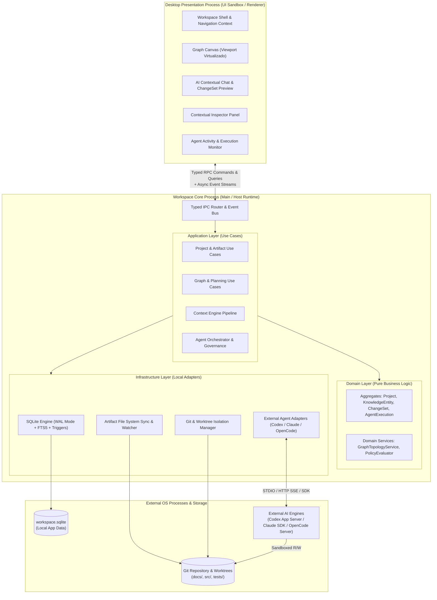
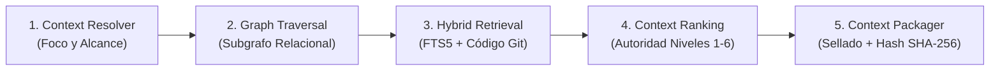
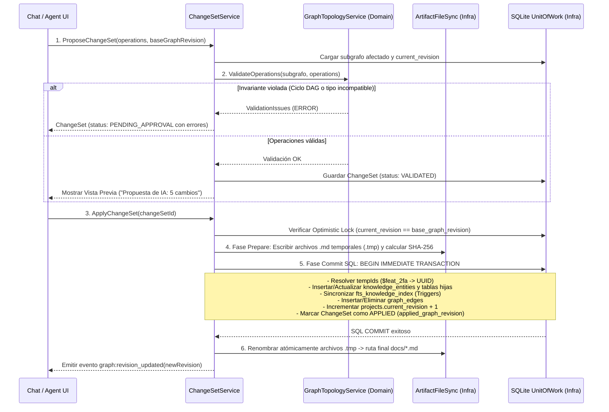
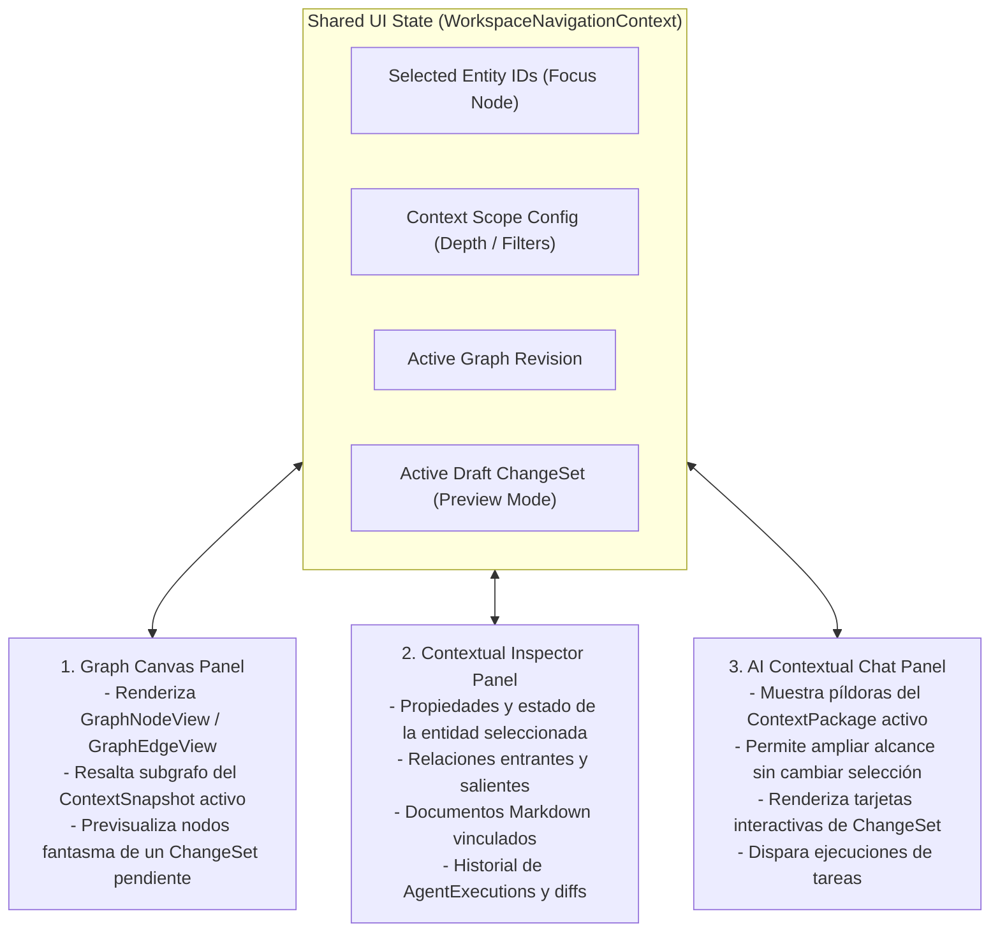

# Technical Architecture Specification v1 (`ARCHITECTURE.md`)

**Estado del Documento:** Consolidado y Alineado · Versión 1.1  
**Paradigma Arquitectónico:** Modular Monolith · Desktop-First · Local-First  
**Dependencias Documentales:** `docs/domain/DOMAIN.md` (Domain Model Specification v1.1)  
**Propósito:** Especificar la arquitectura física, el diseño por capas, los contratos de comunicación inter-proceso (IPC), el motor de resolución de contexto (`ContextEngine`), el aplicador transaccional de cambios (`ChangeSetApplier`), la capa de integración de motores de IA (`AgentIntegrationLayer`) y el aislamiento de ejecución sobre Git.

---

## 1. Visión General del Sistema y Topología de Procesos

El sistema se construye como un **Monolito Modular Desktop-First y Local-First**. No requiere servidores en la nube propios, microservicios ni bases de datos remotas para operar. Toda la inteligencia del proyecto, el estado estructural y la gobernanza residen en la máquina del desarrollador.

### 1.1. Topología de Ejecución (Dual-Process Desktop Architecture)

Independientemente del contenedor de escritorio elegido (Electron con Node.js o Tauri con Sidecar/Rust), el runtime se divide estrictamente en dos espacios de ejecución aislados para proteger la interfaz de usuario y garantizar la seguridad del sistema operativo:



### 1.2. Principios de Aislamiento de Procesos

1. **Cero Acceso Directo desde la UI:** El proceso de presentación (React/UI) no tiene acceso al sistema de archivos (`fs`), ni a SQLite, ni a procesos hijos (`child_process`), ni a las llaves o SDKs de los motores de IA. Toda operación cruza el puente **Typed IPC**.
2. **Event-Driven UI:** La interfaz no hace *polling* sobre las ejecuciones de los agentes ni sobre el estado de los archivos. El `Workspace Core Process` emite eventos tipados en tiempo real hacia la UI (`execution:event_received`, `graph:revision_updated`, `artifact:sync_status_changed`).
3. **Inversión de Dependencias Estricta:** La capa `domain/` no importa ningún módulo de `infrastructure/` ni librerías externas de I/O. Define interfaces (puertos) que `infrastructure/` implementa (adaptadores).

---

## 2. Arquitectura por Capas y Reglas de Dependencia

### 2.1. Matriz de Responsabilidades por Capa

| Capa | Directorio Raíz | Responsabilidad Principal | Dependencias Permitidas | Prohibiciones Estrictas |
| :--- | :--- | :--- | :--- | :--- |
| **Presentation** | `src/desktop/` | Renderizado visual del grafo, chat contextual, inspector de propiedades, vista previa de `ChangeSets` y monitor de agentes. | `src/shared/` (contratos y tipos). Comunicación con `application/` solo vía IPC. | Prohibido importar `domain/`, `infrastructure/`, `sqlite`, `fs` o SDKs de agentes. |
| **Application** | `src/application/` | Orquestación de casos de uso, manejo de transacciones (`UnitOfWork`), coordinación entre el grafo, archivos y adaptadores de agentes. | `src/domain/`, `src/shared/`. | Prohibido contener SQL crudo, llamadas directas a comandos Git de consola o lógica de componentes UI. |
| **Domain** | `src/domain/` | Entidades tipadas, raíces de agregado, validación de invariantes (DAG, matriz de aristas), cálculo de prioridades de contexto y políticas. | `src/shared/` únicamente. Código 100% puro y determinista. | Prohibido cualquier I/O asíncrono de red, disco o base de datos. |
| **Infrastructure** | `src/infrastructure/` | Implementación de repositorios SQLite, índice FTS5, sincronizador Markdown, gestor de `git worktree` y adaptadores de motores. | `src/application/` (puertos), `src/domain/`, `src/shared/`, librerías de sistema. | Prohibido alterar el estado de negocio saltándose las invariantes del dominio. |
| **Shared** | `src/shared/` | DTOs serializables, contratos IPC, esquemas de validación y eventos transversales. | Ninguna capa interna. | Prohibido incluir lógica de negocio o implementaciones de infraestructura. |

---

## 3. Diseño Profundo del `ContextEngine` (Pipeline de 5 Etapas)

El `ContextEngine` es el corazón intelectual del Workspace. Su objetivo es construir un `ContextSnapshot` determinista, auditable y ajustado al presupuesto de tokens antes de cada interacción de planificación o ejecución de tarea.



### 3.1. Especificación de las 5 Etapas del Pipeline

#### Etapa 1: `ContextResolver` (Identificación del Foco)
* Recibe el comando de entrada: `focusEntityId` (ej. `TASK-125`), el modo de operación (`PLANNING`, `EXECUTION`, `REVIEW`, `QUERY`) y el presupuesto máximo de tokens (`maxAllowedTokens`, ej. 32,000 tokens).
* Resuelve la cadena jerárquica ascendente completa mediante una consulta recursiva sobre `parent_id`:
  `WorkItem (TASK-125)` $\rightarrow$ `Feature (FEAT-04)` $\rightarrow$ `Module (MOD-01)` $\rightarrow$ `ProjectRoot (PROJ-01)`.
* Extrae las restricciones globales (`rules_json`) y políticas activas del proyecto (**Nivel 1 de Autoridad**).

#### Etapa 2: `GraphTraversal` (Expansión Relacional Dirigida)
Ejecuta una CTE recursiva en SQLite acotada por profundidad (`maxHops`, por defecto `1` para consultas estándar y `2` cuando se solicitan dependencias indirectas) siguiendo reglas semánticas según el tipo de arista:

1. **Decisiones Arquitectónicas (`AFFECTS` y `SUPERSEDES`):**
   * Busca todos los `DecisionRecord` conectados mediante `AFFECTS` al nodo foco, a su `Feature` padre, a su `Module` padre o a `PROJECT_ROOT`.
   * Filtra únicamente aquellos con `status = 'ACCEPTED'`. Si un ADR tiene una arista entrante `SUPERSEDES` desde otro ADR aceptado, queda descartado automáticamente y se registra en `excludedSources` con motivo `'SUPERSEDED_DECISION'` (**Nivel 2 de Autoridad**).
2. **Especificaciones y Requerimientos (`IMPLEMENTS`, `SATISFIES`, `DOCUMENTED_BY`):**
   * Recupera los `Requirement` asociados a la tarea o feature y sus criterios de aceptación.
   * Localiza los `Artifact` de tipo `SPEC` e `IMPLEMENTATION_PLAN` conectados vía `DOCUMENTED_BY` (**Nivel 3 de Autoridad**).
3. **Anclajes de Código (`TOUCHES_CODE` y `VERIFIED_BY`):**
   * Recupera todas las entidades `CodeReference` asociadas al foco o a su feature (**Nivel 4 de Autoridad**).
4. **Dependencias Operativas (`DEPENDS_ON`):**
   * Recupera los `WorkItem` de los cuales depende la tarea actual, incluyendo el resumen de sus ejecuciones completadas (`result_summary` y aristas `MODIFIES` / `GENERATED_BY`) (**Nivel 5 de Autoridad**).

#### Etapa 3: `HybridRetrieval` (Verificación en Disco y Búsqueda Complementaria)
* **Validación contra el Repositorio Real (Anti-Drift):**
  Para cada `Artifact`, `DecisionRecord` y `CodeReference` recolectado en la Etapa 2, el servicio lee el archivo físico desde el repositorio Git (o worktree activo) y calcula su `SHA-256`.
  * Si el archivo Markdown en disco cambió respecto a `content_hash` en SQLite, se marca la entidad como `DRIFTED`, se utiliza el contenido real del disco y se sincroniza el índice `fts_knowledge_index`.
  * Para `CodeReference`, se extrae el rango de líneas actual o el archivo completo en el commit `HEAD` vigente.
* **Recuperación Full-Text (FTS5) y Semántica Progresiva:**
  Cuando la consulta del usuario en el chat incluye términos no cubiertos por los vecinos directos del grafo, se ejecuta una consulta sobre la tabla virtual `fts_knowledge_index` para sugerir entidades relevantes no conectadas explícitamente.

#### Etapa 4: `ContextRanking` (Presupuestación y Corte por Autoridad)
Cada fragmento candidato se convierte en un `ContextSourceEntry` candidato y se puntúa con la siguiente función de prioridad lexicográfica:

$$\text{Score}(item) = (\text{AuthorityTier}^{-1}, \text{GraphDistance}^{-1}, \text{TextRelevanceScore})$$

El algoritmo de empaquetado (`Knapsack Greedy por Niveles`) llena el presupuesto `maxAllowedTokens`:
1. **Bloque Innegociable (Niveles 1 y 2):** Se insertan todas las restricciones del proyecto y los ADRs `ACCEPTED` que afectan el alcance. *Invariante:* Nunca se truncan por contenido de niveles inferiores.
2. **Bloque de Especificación (Nivel 3):** Se inserta la definición del `WorkItem`, los `Requirement` y la especificación funcional (`specification.md`).
3. **Bloque de Realidad Técnica (Nivel 4):** Se insertan las referencias de código (`CodeReference`) reales del repositorio.
4. **Bloque de Contexto Histórico y Conversacional (Niveles 5 y 6):** Se agregan documentos generales (`PRD.md`, `ARCHITECTURE.md`), salidas de tareas previas y turnos recientes del chat hasta agotar `maxAllowedTokens`.
5. Cualquier candidato que supere el presupuesto restante no se descarta en silencio: se añade a `ContextSnapshot.excludedSources` con `exclusionReason = 'TOKEN_BUDGET_EXCEEDED'`.

#### Etapa 5: `ContextPackager` (Sellado Inmutable)
* Persiste el registro en la tabla `context_snapshots` junto con `repository_commit` (SHA actual de Git) y `graph_revision` (entero actual de `projects.current_revision`).
* Genera la representación estructurada (XML/Markdown etiquetado con provenance IDs) que será entregada al `AgentAdapter` o al motor de Chat, e informa a la UI exactamente qué píldoras de contexto se utilizaron.

---

## 4. Motor Transaccional de `ChangeSets` (Chat / Agente $\rightarrow$ Grafo y Archivos)

Para garantizar que ni el chat ni ningún agente corrompan el modelo del proyecto, toda modificación estructural atraviesa el `ChangeSetPipeline`.



### 4.1. Resolución de Identificadores Simbólicos (`tempId`)
Cuando la IA propone en un solo turno crear un módulo, una feature, tres tareas y sus aristas de dependencia, aún no existen UUIDs en la base de datos.
* El `ChangeSetApplier` construye en memoria un diccionario `Map<TempId, RealUUID>` al inicio de la transacción.
* Primero ejecuta las operaciones de creación de nodos (`CREATE_MODULE`, `CREATE_FEATURE`, `CREATE_REQUIREMENT`, `CREATE_WORK_ITEM`, `CREATE_DECISION_RECORD`, `UPSERT_ARTIFACT`) en orden topológico de `parentId`, poblando el mapa y asignando las claves secuenciales legibles (`FEAT-05`, `TASK-108`).
* A continuación, ejecuta las operaciones `CREATE_RELATIONSHIP` sustituyendo cada `sourceId` y `targetId` que comience con `$` por su `RealUUID` definitivo.

### 4.2. Atomicidad Híbrida (SQLite + Sistema de Archivos Markdown)
Dado que un `ChangeSet` puede crear tanto nodos en SQLite como archivos físicos en `docs/` (ej. `specification.md` o `ADR-004.md`), el aplicador implementa un protocolo de **Two-Phase Commit Local**:
1. **Stage en Disco:** Los contenidos Markdown se escriben primero en archivos ocultos de staging dentro del directorio local del workspace (`<filename>.changeset.tmp`) y se calcula su `content_hash`. Si falla el disco (permisos, ruta inválida), se aborta antes de abrir la transacción SQLite.
2. **Transacción SQLite (`BEGIN IMMEDIATE`):** Se aplican todos los cambios en las tablas relacionales, se actualiza el índice `FTS5` (vía triggers para metadatos y actualización directa para `body_content`), se registra el `content_hash` esperado y se incrementa `current_revision`.
3. **Swap Atómico en Disco:** Una vez confirmada la transacción SQLite, los archivos `.tmp` se mueven atómicamente (`fs.rename`) a sus rutas definitivas dentro del repositorio Git.

---

## 5. Arquitectura del `Agent Integration Layer` y Ejecución Aislada

El Workspace separa completamente el concepto de **Agente de Dominio (`AgentProfile`)** del **Motor de Ejecución (`AgentProvider`)**.

### 5.1. Estructura de Adaptadores y Normalización de Eventos

```mermaid
flowchart TB
    ORCH["AgentOrchestrator
(Application Service)"]
    GOV["GovernanceInterceptor
(Policy & Approval Gate)"]
    PORT["<<interface>>
AgentAdapter"]

    subgraph ADAPTERS["Infrastructure: Engine Adapters"]
        CODEX["CodexAdapter
(App Server / SDK)"]
        CLAUDE["ClaudeCodeAdapter
(Claude Agent SDK)"]
        OPENCODE["OpenCodeAdapter
(OpenCode HTTP/SDK)"]
    end

    ORCH --> GOV
    GOV --> PORT
    PORT <|.. CODEX
    PORT <|.. CLAUDE
    PORT <|.. OPENCODE
```

Cada adaptador encapsula las particularidades de su proveedor y traduce su flujo nativo a la secuencia canónica de `AgentEvent` definida en `DOMAIN.md`:

| Proveedor | Superficie de Integración Técnica | Mecanismo de Transporte | Manejo de Permisos y Aprobaciones |
| :--- | :--- | :--- | :--- |
| **Codex** | Codex SDK / App Server Protocol | Proceso local / JSON-RPC Stream | Intercepta eventos de autorización del App Server y los mapea a `APPROVAL_REQUIRED` invocando `respondToApproval(executionId, requestId, decision)`. |
| **Claude Code** | `@anthropic-ai/claude-code` (Agent SDK TypeScript) | Subproceso gestionado / AsyncGenerator | Utiliza el callback `canUseTool` / hooks de permisos del SDK para consultar al `GovernanceInterceptor` antes de ejecutar comandos o editar archivos. |
| **OpenCode** | OpenCode TypeScript SDK + Local Server | HTTP REST + Server-Sent Events (SSE) | Conecta con la sesión del servidor local, suscribe al bus de eventos SSE y administra interrupciones y respuestas de permisos vía API. |

### 5.2. Gestión de Capacidades Declaradas (`AgentCapabilities`)
El `AgentOrchestrator` consulta los 6 indicadores de `adapter.getCapabilities()` (`supportsResume`, `supportsStreaming`, `supportsApprovals`, `supportsCancellation`, `supportsStructuredOutput`, `supportsWorktrees`) antes de iniciar cualquier ejecución:
* Si `supportsWorktrees === true` y la política lo exige, el Workspace aprovisiona un Git worktree independiente.
* Si `supportsApprovals === false` pero la tarea requiere ejecutar comandos fuera de la lista blanca (`allowedCommands`), el orquestador bloquea el inicio o exige degradar a un modo estrictamente supervisado, **nunca** fingiendo un sistema de pausa que el motor no posee.
* Si `supportsStructuredOutput === true` (ej. durante tareas de `PLANNER` o `ARCHITECT`), el orquestador inyecta el JSON Schema del `ChangeSet` para obtener propuestas deterministas.

### 5.3. Ciclo de Aislamiento con Git Worktrees y Validación Post-Ejecución

Para proteger el árbol de trabajo principal del desarrollador durante las ejecuciones autónomas (`AgentExecution`):

1. **Preparación (`PREPARING_CONTEXT`):**
   * `GitIsolationService` registra el SHA actual de la rama base (`initial_commit`).
   * Crea una rama dedicada `ws/exec-<task-key>-<short-exec-id>` y monta un worktree aislado en:
     `<Workspace-Local-Dir>/projects/<project-id>/worktrees/<execution-id>/`
   * Configura `ExecutionSandboxConfig.workingDirectory` apuntando exclusivamente a ese worktree.
   * `ContextEngine` sella el `ContextSnapshot` y se asocia su ID en `agent_executions.context_snapshot_id`.
2. **Ejecución (`RUNNING` / `AWAITING_APPROVAL`):**
   * El motor externo opera dentro del worktree.
   * Cada evento recibido del `AsyncIterable<AgentEvent>` se persiste inmediatamente en `agent_events` y en el archivo `events.jsonl` para tolerancia a fallos ante cierres inesperados.
3. **Validación (`VALIDATING`):**
   * Cuando el motor finaliza, `ExecutionValidator` ejecuta `git status --porcelain` y `git diff <initial_commit>` dentro del worktree.
   * **Verificación de Fronteras (`Sandbox Audit`):** Comprueba cada archivo modificado contra `AutonomyPolicy.writablePaths` y `deniedPaths`. Si el agente modificó un archivo prohibido (ej. `.env` o un ADR aceptado sin permiso), la validación falla automáticamente (`FAILED`) y revierte la modificación no autorizada.
   * **Ejecución de Pruebas:** Si el proyecto o la tarea definen comandos de verificación (ej. suite de tests unitarios), el validador los ejecuta en el worktree y captura el reporte (`TestExecutionReport`) en `test-output.log`.
4. **Cierre y Feedback Loop (`COMPLETED`):**
   * Se genera el archivo `changes.patch` y se registran las filas en `execution_file_diffs`.
   * Se actualizan o crean las entidades `CodeReference` y las aristas `MODIFIES` / `GENERATED_BY` con `provenance = 'EXECUTION'` y `execution_id = executionId`.
   * El `WorkItem` transiciona a `IN_REVIEW` para que el desarrollador inspeccione el diff desde el Workspace y decida fusionar (`Merge to base branch`) o solicitar ajustes.

---

## 6. Arquitectura de Persistencia e Indexación Híbrida

### 6.1. Configuración de Alto Rendimiento en SQLite
Cada proyecto posee su propio archivo `workspace.sqlite` alojado en el directorio de datos de la aplicación. Al abrir la conexión, el motor de persistencia aplica obligatoriamente los siguientes pragmas:

```sql
PRAGMA journal_mode = WAL;          -- Concurrencia de lecturas de UI mientras un agente escribe eventos
PRAGMA synchronous = NORMAL;        -- Balance óptimo entre durabilidad y velocidad en disco local
PRAGMA foreign_keys = ON;           -- Integridad referencial estricta en cascadas y aristas
PRAGMA busy_timeout = 5000;         -- Evita bloqueos instantáneos en picos de escritura de eventos
PRAGMA temp_store = MEMORY;         -- Acelera CTEs recursivas de recorrido del grafo
```

### 6.2. Estrategia de Búsqueda Full-Text (FTS5) y Sincronización Documental
* Se define una tabla virtual `fts_knowledge_index` utilizando el módulo **SQLite FTS5** con tokenizador `unicode61 remove_diacritics 2`.
* **Triggers Automáticos + Sincronización de Cuerpo:** Los triggers `AFTER INSERT`, `AFTER UPDATE` y `AFTER DELETE` sobre `knowledge_entities` mantienen sincronizados `display_key`, `title` y `summary` de forma transparente. Cuando se persiste un `DecisionRecord` o un `Artifact`, el repositorio actualiza `body_content` en `fts_knowledge_index`.
* **File System Watcher (`ArtifactWatcherService`):**
  Mientras el proyecto está abierto, un observador ligero monitorea la carpeta `<Repo>/docs/`. Si el usuario edita un archivo Markdown en su editor externo (ej. VS Code) y lo guarda:
  1. Se recalcula el hash SHA-256 del archivo.
  2. Si difiere del almacenado en `artifacts.content_hash`, se actualiza el contenido indexado en `fts_knowledge_index`.
  3. Se emite el evento `artifact:sync_status_changed` a la interfaz para reflejar la sincronización inmediata sin perder la trazabilidad del grafo.

---

## 7. Arquitectura de la Interfaz y Sincronización de Contexto (Graph + Chat + Inspector)

La capa de presentación (`src/desktop/`) se diseña alrededor de un estado compartido central: el **`WorkspaceNavigationContext`**. El grafo, el chat y el inspector no son vistas aisladas, sino tres lentes sincronizados sobre el mismo modelo.



### 7.1. Mecanismo de "Ghost Preview" para `ChangeSets` en el Grafo
Cuando el Chat genera un `ChangeSet` en estado `VALIDATED` (pendiente de aplicar):
* El estado `DRAFT_CS` se activa en la UI.
* El `Graph Canvas` superpone visualmente los nuevos nodos (`CREATE_FEATURE`, `CREATE_WORK_ITEM`) y las nuevas aristas (`CREATE_RELATIONSHIP`) con estilo punteado/translúcido ("nodos fantasma") antes de que el usuario presione **"Aplicar cambios"**.
* Al confirmar la aplicación, el `Workspace Core Process` ejecuta la transacción, incrementa `current_revision` y los nodos fantasma se consolidan como nodos reales del grafo.

---

## 8. Contratos del Bus IPC (Comunicación Presentación $\leftrightarrow$ Core)

El contrato entre el frontend y el proceso principal se divide en tres canales tipados:

```typescript
// src/shared/contracts/ipc-contracts.ts

// 1. COMANDOS (Mutaciones que alteran estado o inician procesos)
export interface WorkspaceIpcCommands {
  'project:create': (input: CreateProjectInput) => Promise<ProjectSummaryDto>;
  'project:open': (projectId: string) => Promise<WorkspaceLoadedStateDto>;
  'changeset:propose_from_chat': (input: ChatPromptInput) => Promise<ChangeSet>;
  'changeset:apply': (changeSetId: string) => Promise<{ newRevision: number }>;
  'changeset:reject': (changeSetId: string, reason?: string) => Promise<void>;
  'execution:start': (input: StartTaskExecutionInput) => Promise<{ executionId: string }>;
  'execution:interrupt': (executionId: string) => Promise<void>;
  'execution:respond_approval': (input: {
    executionId: string;
    requestId: string;
    decision: ApprovalDecision;
  }) => Promise<void>;
}

// 2. CONSULTAS (Lecturas rápidas sin efectos secundarios)
export interface WorkspaceIpcQueries {
  'graph:get_view': (projectId: string, filter?: GraphFilterDto) => Promise<{
    revision: number;
    nodes: GraphNodeView[];
    edges: GraphEdgeView[];
  }>;
  'entity:get_inspector_details': (entityId: string) => Promise<EntityInspectorDto>;
  'context:preview_package': (input: PreviewContextInput) => Promise<ContextSnapshot>;
  'execution:get_forensic_detail': (executionId: string) => Promise<ExecutionForensicDto>;
}

// 3. EVENTOS (Push asíncrono desde el Core hacia la UI)
export interface WorkspaceIpcEvents {
  'graph:revision_updated': { projectId: string; revision: number; changeSetId?: string };
  'execution:status_changed': { executionId: string; workItemId: string; status: ExecutionStatus };
  'execution:event_received': { executionId: string; event: AgentEvent };
  'artifact:sync_status_changed': { entityId: string; relativePath: string; syncStatus: string };
}
```

---

## 9. Estructura Física de Módulos y Paquetes del Código (`src/`)

La estructura de directorios refleja exactamente la arquitectura por capas y los seis módulos de dominio, manteniendo el proyecto desacoplado y preparado para evolucionar desde el MVP:

```text
src/
├── desktop/                              # CAPA DE PRESENTACIÓN (UI Renderer)
│   ├── shell/                            # Layout principal, barra de estado, selector de proyecto
│   ├── state/                            # WorkspaceNavigationContext y sincronización IPC
│   └── presentation/
│       ├── graph/                        # Canvas del grafo, layout jerárquico, Ghost Preview de ChangeSets
│       ├── chat/                         # Chat contextual, visor de Context Pills, tarjetas de ChangeSet
│       ├── inspector/                    # Panel de propiedades, relaciones, historial y acciones rápidas
│       ├── documents/                    # Visor/editor Markdown sincronizado con Artifacts y ADRs
│       ├── agents/                       # Monitor de AgentExecutions, visor de diffs, modal de aprobaciones
│       └── projects/                     # Creación de proyecto, vinculación Git, configuración de reglas
│
├── application/                          # CAPA DE APLICACIÓN (Casos de Uso y Orquestación)
│   ├── ports/                            # Interfaces de repositorios, UnitOfWork, FileSync y GitService
│   ├── projects/                         # CreateProject, OpenProject, SyncRepositoryState
│   ├── graph/                            # GetGraphView, GetEntityInspectorDetails, ValidateSubgraph
│   ├── artifacts/                        # CreateArtifact, SyncMarkdownFiles, DetectArtifactDrift
│   ├── planning/                         # GenerateChangeSetProposal, ValidateChangeSet, ApplyChangeSet
│   ├── context/                          # ContextEngine (Resolver, Traversal, Retrieval, Ranking, Packager)
│   ├── agents/                           # ManageAgentProfiles, CheckProviderAvailability
│   ├── execution/                        # AgentOrchestrator, StartWorkItemExecution, ExecutionValidator
│   └── approvals/                        # GovernanceInterceptor, HandleApprovalRequest
│
├── domain/                               # CAPA DE DOMINIO (Núcleo Puro — Cero I/O)
│   ├── projects/                         # Project, Repository, ProjectRule, GraphRevision
│   ├── work-management/                  # ProjectRoot, Module, Feature, Requirement, WorkItem, Milestone
│   ├── graph/                            # KnowledgeEntity, GraphRelationship, GraphTopologyService (DAG)
│   ├── artifacts/                        # DecisionRecord (ADR), Artifact, CodeReference, ContentHash
│   ├── knowledge/                        # ContextSnapshot, ContextAuthorityTier, ChangeSet, ChangeSetOperation
│   ├── agents/                           # AgentProfile, AgentExecution, AgentEvent, AgentCapabilities
│   └── governance/                       # AutonomyPolicy, ApprovalRequest, SandboxAuditRules
│
├── infrastructure/                       # CAPA DE INFRAESTRUCTURA (Adaptadores Locales)
│   ├── ipc/                              # Servidor IPC tipado y emisor de eventos hacia Desktop UI
│   ├── persistence/
│   │   ├── sqlite/                       # Conexión WAL, migraciones, triggers y UnitOfWork transaccional
│   │   ├── repositories/                 # Implementación SQL de los repositorios del dominio
│   │   └── search/                       # Índice FTS5 (fts_knowledge_index) y consultas de ranking
│   ├── filesystem/                       # Lectura/escritura atómica de Markdown (.tmp swap) y FileWatcher
│   ├── git/                              # Inspección de commits, diffs y gestión de Git Worktrees
│   ├── agent-adapters/
│   │   ├── base/                         # Utilidades de streaming, normalización y manejo de procesos
│   │   ├── codex/                        # CodexAdapter (SDK / App Server)
│   │   ├── claude/                       # ClaudeCodeAdapter (Agent SDK)
│   │   └── opencode/                     # OpenCodeAdapter (SDK / Local Server)
│   └── execution-runtime/                # Ejecutor aislado de pruebas y recolector de evidencias (.patch/.log)
│
└── shared/                               # CONTRATOS TRANSVERSALES
    ├── contracts/                        # Contratos IPC, GraphNodeView, GraphEdgeView, DTOs
    ├── events/                           # Definiciones de eventos de dominio y de interfaz
    └── types/                            # Tipos utilitarios, Result<T, E> y errores tipados
```

---

## 10. Mapeo Arquitectónico del Escenario de Prueba de Fuego (MVP End-to-End)

Para validar que todos los subsistemas de esta arquitectura encajan sin fisuras, así fluye técnicamente el escenario obligatorio del MVP a través de las capas:

| Paso del Escenario MVP | Caso de Uso (`application/`) | Intervención de Dominio (`domain/`) | Acción de Infraestructura (`infrastructure/`) | Resultado Observable en UI (`desktop/`) |
| :--- | :--- | :--- | :--- | :--- |
| **1. Creación del proyecto** | `CreateProjectUseCase` | Instancia `Project` (`revision = 1`), `ProjectRoot` (`PROJ-01`) y `Repository` primario. | Crea `workspace.sqlite`, inicializa tablas/triggers y estructura `docs/` en el repo Git. | Se abre el Workspace con el nodo raíz `PROJ-01` en el grafo. |
| **2. Análisis y Generación Inicial** | `GenerateInitialProjectPlanUseCase` | Construye el primer `ContextSnapshot` (Nivel 1) y solicita al perfil `ARCHITECT` un `ChangeSet` fundacional. | Invoca al adaptador con salida estructurada; valida el `ChangeSet` resultante. | El Chat muestra la propuesta con PRD, arquitectura, módulos y features; el grafo los previsualiza en modo fantasma. |
| **3. Construcción del Grafo y Documentos** | `ApplyChangeSetUseCase` | `GraphTopologyService` verifica aciclicidad y matriz de aristas; incrementa `revision = 2`. | Ejecuta el Commit Híbrido: escribe `PRD.md` y `ARCHITECTURE.md` en disco e inserta entidades y aristas en SQLite. | El grafo renderiza los módulos, features, requerimientos y sus documentos vinculados. |
| **4. Planificación de una Feature** | `PlanFeatureImplementationUseCase` | El usuario selecciona una `Feature`. `ContextEngine` arma el paquete (Niveles 1, 2 y 3). | El perfil `PLANNER` devuelve un `ChangeSet` con `implementation-plan.md`, `WorkItems` (`TASK`) y aristas `DEPENDS_ON` + `IMPLEMENTS`. | Al aplicar el `ChangeSet` (`revision = 3`), aparecen las tareas conectadas bajo la feature en el grafo. |
| **5. Ejecución de una Tarea** | `StartWorkItemExecutionUseCase` | Valida que la tarea esté `READY`; crea `AgentExecution` (`PREPARING_CONTEXT` $\rightarrow$ `RUNNING`). | `GitIsolationService` crea el worktree; `ContextEngine` sella el `ContextSnapshot`; el `AgentAdapter` inicia el motor y emite `AgentEvents`. | El panel de actividad transmite en vivo las herramientas invocadas y los archivos editados; el inspector muestra el contexto exacto enviado. |
| **6. Validación y Actualización** | `FinalizeExecutionUseCase` | `SandboxAuditRules` valida rutas tocadas; transiciona ejecución a `COMPLETED` y tarea a `IN_REVIEW` (y `DONE` tras aprobación). | Ejecuta tests en el worktree, guarda `changes.patch` y `test-output.log`, registra `execution_file_diffs`, crea aristas `MODIFIES` y propone `ChangeSet` de feedback si aplica. | La tarea cambia de estado en el grafo, el diff queda auditado permanentemente y el conocimiento del proyecto queda actualizado para el siguiente agente. |

---

## 11. Mitigación Arquitectónica de los Tres Riesgos Críticos

1. **Riesgo 1: Convertir el grafo en un simple administrador de tareas.**
   * *Defensa arquitectónica:* La tabla `knowledge_entities` y la vista del grafo tratan a `DecisionRecord` (ADR), `Requirement`, `Artifact` y `CodeReference` como ciudadanos de primera clase. Además, el `ContextEngine` exige recorrer las aristas `AFFECTS`, `SATISFIES` y `DOCUMENTED_BY` para alimentar a los agentes; una tarea huérfana de conocimiento produce una advertencia de contexto incompleto.
2. **Riesgo 2: Convertir el Context Engine en un buscador de documentos.**
   * *Defensa arquitectónica:* El pipeline del `ContextEngine` ejecuta primero la resolución jerárquica (Etapa 1) y el recorrido determinista del grafo (Etapa 2) antes de cualquier búsqueda textual (Etapa 3), aplicando un corte estricto por niveles de autoridad (Etapa 4) donde las políticas y ADRs aceptados jamás son desplazados por similitud de texto.
3. **Riesgo 3: Dejar que el agente sea dueño del proyecto.**
   * *Defensa arquitectónica:* Ningún adaptador tiene acceso a la base de datos SQLite ni puede mutar el grafo directamente. Toda modificación estructural requiere emitir un `ChangeSet` validado por el dominio, y toda modificación de código ocurre dentro de un Git worktree gobernado por una `AutonomyPolicy` y auditado en la fase `VALIDATING` antes de impactar el proyecto.