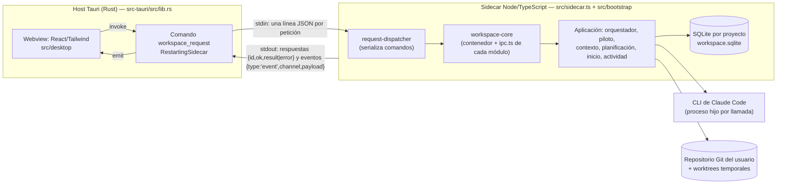

# Arquitectura actual

Estado real del código al 2026-11-11 (rama `feat/claude-code`). Las especificaciones originales (`docs/ARCHITECTURE.md`, `docs/DOMAIN.md`) siguen siendo la referencia del diseño, pero son anteriores a la migración a Claude Code, a las ejecuciones aisladas, al piloto y al asistente de inicio; ante una diferencia, manda este documento y el código.

## 1. Dos procesos

- **Host Rust.** Arranca un proceso Node persistente (el *sidecar*) con `GRAPHDEV_WORKSPACE_ROOT` apuntando al directorio de datos de la aplicación. En desarrollo ejecuta `dist/main/sidecar.js` (entrada estable `src/sidecar.ts`); en el paquete, el Node y el núcleo incluidos como recursos. Escribe el `stderr` del sidecar en `<datos>/logs/sidecar.log`.
- **Protocolo.** Una línea JSON por petición (`{id, request:{channel,…}}`) por `stdin`; el sidecar responde por `stdout` con `{id, ok, result|error}` y emite eventos como `{type:'event', channel, payload}`, que el host reenvía a la interfaz con `emit`. El renderer no toca el sistema de archivos ni SQLite.
- **Tiempos de espera por canal** (host): 60 s por defecto y 330 s para `changeset:propose_from_chat` (el planificador de TypeScript se rinde a los 300 s). Un tiempo agotado libera al llamador y las peticiones posteriores siguen funcionando.
- **Concurrencia.** El despachador (`request-dispatcher.ts`) ejecuta **uno a uno y en orden** los comandos que mutan estado compartido (`SERIALIZED_CHANNELS`) y deja en paralelo las consultas y la propuesta de ChangeSet, para que una operación lenta no bloquee la interfaz. Las respuestas pueden llegar desordenadas; cada una lleva su `id`.
- **Reinicio.** `RestartingSidecar` mantiene un núcleo vivo; si murió, la siguiente petición lo reinicia.
- **El núcleo no se recarga en vivo:** tras cambiar código de `src/` (salvo la interfaz) hay que reiniciar `npm run desktop`.

## 2. Capas del núcleo

Monolito modular (desde A1–A2 de `docs/PROPUESTA_ARQUITECTURA.md`, 2026-11-12). Cada módulo vive en `src/modules/<módulo>/` con `domain/` (reglas puras), `application/` (casos de uso y `ports/`), `infrastructure/` (adaptadores: SQLite, Git, Claude…), `ipc.ts` (sus canales) e `index.ts` (lo único que otros módulos pueden importar). Las reglas están en `CLAUDE.md` y las comprueba `npm run check:arch`.

| Carpeta | Contenido |
| :--- | :--- |
| `src/sidecar.ts` | Entrada estable del núcleo (`dist/main/sidecar.js`). |
| `src/bootstrap/` | `workspace-core.ts` (une contenedor y router), `container.ts` y `compose/*.ts` (los únicos que crean adaptadores), `ipc-router.ts`, `request-dispatcher.ts`, `project-workspace-store.ts` y `handlers/` (flujos que cruzan módulos: abrir proyecto, inspector, propuesta desde el chat…). |
| `modules/projects` | Proyecto, repositorio, catálogo de stacks, acceso del agente (R1), escaneo del repositorio, carpetas de proyectos. |
| `modules/knowledge` | Grafo, topología, `ChangeSet` y su aplicación transaccional, estado de ADR y tareas, vista del grafo e inspector. |
| `modules/planning` | Planificador de ChangeSets (Claude; Codex sin cablear), validador, referencias de Planificar, `UI_SPEC`. El esquema de salida vive en `planner-schema.ts`. El cambio de stack de un proyecto ya iniciado (`stack-change.ts`) completa `SET_PROJECT_PROFILE` con el perfil del catálogo antes de guardar la propuesta. |
| `modules/inception` | Asistente de inicio, motor y contrato, traductor de referencias, prototipos. |
| `modules/context` | Motor de contexto (resolución, recorrido, ranking, empaquetado) y `ContextSnapshot`. |
| `modules/execution` | `AgentOrchestrator`: una fachada; desde A3 cada acción vive en su propio archivo de `application/` (`start-execution`, `prepare-run`, `run-lifecycle`, `accept-execution`, `agent-proposal`, `feature-branches`, `integrate-feature-branch`, `execution-policy`, `execution-queries`) y trabaja sobre el `ExecutionKernel` compartido. El prompt de la tarea está en `application/prompts/task-prompt.ts`. La persistencia se reparte en repositorios `sqlite-execution-*.ts` (uno por tema) detrás de la fachada `SqliteAgentExecutionRepository`; su puerto se compone de ocho puertos pequeños (`ports/execution-store-port.ts`). También: gobernanza, adaptador de Claude Code (Codex sin cablear), validador del diff, worktrees, revisión. |
| `modules/autopilot` | `FeaturePilot` (fachada desde A3: `pilot-control`, `pilot-loop`, `pilot-acceptance` y `pilot-kernel`), política de decisiones, agrupación de tareas, métricas. |
| `modules/environment` | Dependencias del stack, skills empaquetadas, comandos del proyecto. Línea base de verificación (R2): casos de uso `run-verification-baseline`, `get-verification-baseline` y `accept-known-failures`; corre en una copia de la rama base con `GitBaselineRunner` (en `execution/infrastructure`, junto a las comprobaciones de C6). |
| `modules/documents` | Documentos Markdown, watcher de `docs/`, commit de documentos. |
| `modules/activity` | Bandeja de actividad. |
| `src/platform/` | `sqlite/` (base de datos, migraciones, unidad de trabajo), `claude-cli/`, `codex-cli/`. |
| `src/shared/` | `contracts/` (DTO e IPC), `ipc-handlers.ts`, utilidades que comparte la interfaz. |
| `src/desktop/` | Interfaz (`platform/`, `state/`, `presentation/`, `theme/`); MVVM llega en A4. |

`compose/base.ts` conecta un único adaptador de agente: **Claude Code**. `CodexAgentAdapter` y `CodexChangeSetPlanner` siguen en el código, sin cablear (Etapa 4 del plan).

## 3. Dónde vive cada cosa

- **Base de datos:** una por proyecto, en `<datos de la app>/projects/<id>/workspace.sqlite` (ver `docs/BASE_DE_DATOS.md`).
- **Artefactos de ejecución:** `<datos>/projects/<id>/executions/<executionId>/` (incluye el `test-output.log` de las comprobaciones); informes de feature en `<datos>/projects/<id>/reports/`.
- **Worktrees temporales:** `<datos>/projects/<id>/worktrees/<executionId>/`, en una rama `graphdev/<clave>-<id8>`. Las integraciones usan un worktree desechable en `merges/`.
- **Documentos y código del usuario:** en su repositorio Git. Los documentos que escribe la app (ChangeSets, creados o guardados desde la app) se commitean solos.
- **Rama base del proyecto** (plan GIT): `repositories.default_branch`.
  - Se detecta al conectar el repositorio: la rama por omisión del remoto, si no `main`, si no `master`, si no la rama abierta.
  - Se cambia en Ajustes › Repositorio y ramas.
  - Las features salen de ella y se integran en ella. La app nunca usa la rama que el usuario tenga abierta.
- **Rama por feature:** `graphdev/feature/<clave>-<título>`, por ejemplo `graphdev/feature/feat-001-crear-y-consultar-tareas`.
  - Se crea sin tocar el checkout del usuario.
  - Las ramas `feature/…` anteriores se conservan.
- **Documentos:** se escriben y commitean en el checkout del usuario solo si está en la rama base y sin un merge, rebase, cherry-pick, revert o bisect a medias. Si no, se rechaza con la salida en el mensaje.
  - A una feature solo se copian los documentos de la rama base (`SafeGitIsolation.copyPaths`), nunca otros commits.
- **Escrituras de la app en Git:** pasan por `SafeGitIsolation`, que las serializa por repositorio y traduce los errores de Git que puede provocar el usuario.
- **Al abrir el proyecto:** se borran los worktrees de `merges/` que dejó un cierre inesperado.

**Documentación en línea (C1).**

- Cada ejecución puede leer documentación con `WebFetch`, solo en los dominios del proyecto. La lista suma:
  - una base (MDN y npm);
  - los dominios que salen del stack (`projects/domain/doc-domains.ts`);
  - los que añade el usuario en Ajustes › Documentación en línea.
- El orquestador no lo sabe: la composición envuelve el adaptador en `DocumentationAccess`, que añade los dominios a la política de la ejecución y una nota al prompt. Solo lo hace si el motor declara `supportsDocumentationFetch`.
- `claude-permissions.ts` traduce cada dominio en una regla `WebFetch(domain:…)`. Con `dontAsk`, la CLI niega cualquier otro dominio, y el registro de la ejecución guarda la URL de cada lectura.

## 4. Flujo de una ejecución, de «iniciar» a «aceptar»

1. **Iniciar** (`execution:start`, `AgentOrchestrator.start`). Exige: tarea `READY`, dependencias en `DONE`, perfil `DEVELOPER`, modelo disponible, repositorio configurado, sin otra ejecución activa de la tarea. (Con `revisionOf` y `feedback` es una revisión de una ejecución completada cuya tarea está en `IN_REVIEW`.)
2. **Rama de integración de la feature.** Se crea la primera vez desde el `HEAD` del usuario más las ramas de las features de las que depende (fusionadas en un worktree desechable); si ya existe, se pone al día igual. Se rechaza si una feature de la que depende tiene tareas abiertas. Antes de partir se sincronizan los documentos de la rama.
3. **Aislamiento.** `GitIsolationService.prepare` crea un worktree nuevo y una rama `graphdev/…` desde la rama de integración; guarda `initial_commit`, `execution_branch` y `base_branch`.
4. **Contexto.** El motor de contexto resuelve las fuentes **desde el commit de partida de la rama** (no desde la copia de trabajo del usuario), con niveles de autoridad: nivel 1 reglas del proyecto, perfil y convenciones fijadas por tareas aceptadas; después especificaciones y decisiones, resultados de cierre de dependencias y de tareas terminadas de la misma feature (nivel 5) y punteros a código tocado (nivel 4). Los niveles 1–3 se incluyen siempre y avisa si superan el presupuesto. Se guarda un `ContextSnapshot` con el commit.
5. **Ejecución.** El estado pasa a `RUNNING` y la tarea a `IN_PROGRESS`. `ClaudeCodeAdapter` lanza `claude -p --output-format stream-json` con permisos derivados de la política (`--permission-mode dontAsk`, reglas de rutas y comandos), `--setting-sources project,local` y `--disable-slash-commands` (sin la configuración, skills ni plugins personales; `CLAUDE_CODE_DISABLE_AUTO_MEMORY=1`), `--model` si procede y, opcionalmente, `--max-turns` (desactivado por defecto) y `--resume` (la reutilización de sesión por feature está desactivada por defecto). El prompt lleva la tarea, los criterios, el contexto y la política. Los eventos se guardan (`agent_events` y log en disco) y se emiten por `execution:event_received`. Un plazo (`maxExecutionMinutes`, 30 por defecto) detiene el motor y devuelve la tarea a `READY`.
6. **Validación** (estado `VALIDATING`). `ExecutionValidator` audita el diff contra la política (rutas escribibles, solo lectura y denegadas, symlinks, manipulación de `.git`; Git fijado al directorio de administración), registra el diff por archivo, ejecuta los comandos de verificación permitidos y hace el commit en la rama de la ejecución. Pasa a `COMPLETED` o `FAILED`; la tarea queda en `IN_REVIEW` (o vuelve a `READY` si falló).
7. **Aceptar** (`execution:accept`, o automático en `AUTO_ACCEPT`/`PILOT` si la ejecución está `COMPLETED` y al menos un comando de verificación corrió y pasó). `squashMerge` integra la ejecución en la rama de la feature con el mensaje `TASK-n: título` y el id de ejecución; un conflicto deja la tarea en `IN_REVIEW` con `MERGE_CONFLICT`. Después: limpieza del worktree y de la rama, **memoria** (`recordOutcome`: `TaskOutcome` con el resumen de cierre —Hecho, Decisiones, Convenciones, Pendiente—, archivos y comprobaciones; evidencia `CODE_REFERENCE`/`MODIFIES`; las convenciones pasan a nivel 1), tarea a `DONE`, desbloqueo de las dependientes y tratamiento de la propuesta de cambios al plan del agente (bloque `propuestas`) según la política de decisiones.
8. **Pedir ajustes** (`execution:request_changes`) lanza una revisión partiendo del commit anterior con el motivo como contexto.
9. **Integrar la feature** (`feature:integrate`). Con todas las tareas en `DONE`, fusiona la rama de la feature en la rama base con un commit de merge, en un worktree temporal, sin hooks. Rechaza si la rama base está abierta en otro worktree, si hay conflicto o si el checkout del usuario está en esa rama con cambios sin commitear.
10. **Conflictos entre features** (F0b; casos de uso `check-feature-conflicts`, `resolve-feature-conflicts` e `integrate-feature`, con `GitFeatureConflicts`). Antes de integrar, el panel de la feature consulta `feature:check_conflicts` (`git merge-tree`) y oculta «Integrar» si chocaría con la rama base. «Resolver con un agente» (`feature:resolve_conflicts`) junta la rama base en la de la feature, commitea los marcadores y crea una tarea `READY` de la feature con una propuesta `USER_BULK_ACTION`; al aceptarla, la feature se integra sin conflicto. `feature:integrate` rechaza una rama con marcadores.
11. **Comprobaciones de integración** (C6; casos de uso `get-feature-checks` y `run-feature-checks`, con `GitFeatureChecks`).
    - **Qué se comprueba:** las de un perfil del catálogo (`next build`, `vite build`) o el script `build` de un repositorio sin perfil, si las comprobaciones por tarea no lo incluyen ya.
    - **Cómo:** `feature:run_checks` fusiona la feature con la rama base en un worktree desechable de `checks/`, instala el entorno y ejecuta los comandos en segundo plano. Solo toma el candado del repositorio para crear y borrar el worktree.
    - **Bloqueo:** `feature:integrate` se rechaza hasta que hayan pasado con las cabezas actuales de la feature y de la rama base. El resultado vive en memoria, así que tras reiniciar la app hay que volver a comprobar.
    - **Límites de tiempo:** cada comprobación tiene el suyo (`check-timeouts.ts`): 10 minutos para builds y e2e, 2 para el resto. Revisión muestra cada comprobación con su resultado y su duración.

## 5. Piloto automático

`FeaturePilot` (`src/modules/autopilot/application/feature-pilot.ts`) recorre las tareas `READY` de una feature por orden de dependencias, lanza la siguiente, acepta cuando se cumplen las puertas, y reintenta con el error como contexto (el último intento puede usar el modelo de escalamiento). Se pausa (`PAUSED`) al superar el umbral de uso (85 % por defecto) y se reanuda al renovarse la ventana; pasa a `WAITING_USER` con una razón cuando necesita una decisión. Solo corre un piloto activo por proyecto. Cada decisión queda en `pilot_events`.

La política de decisiones (`decision-policy.ts`) clasifica cada operación de una propuesta del agente en cinco categorías configurables (`NEW_TASK`, `TASK_DEPENDENCY`, `TASK_STATUS`, `DECISION_RECORD`, `SCOPE_CHANGE`) como automática o «preguntar», más `PROJECT_FOUNDATION`, que siempre pregunta. Hay un tope de tareas automáticas por feature (5 por defecto). Si toda la propuesta es automática se aplica y el piloto sigue; si no, queda pendiente en Planificar.

## 6. Planificación, inicio y actividad

- **Planificación:** `ClaudeChangeSetPlanner` (`claude -p --json-schema`, sin herramientas ni persistencia) devuelve un borrador de `ChangeSet`; `changeset-validator` lo valida contra la revisión y topología actuales; el grafo muestra nodos fantasma antes de aplicar; aplicar es transaccional (SQLite y Markdown).
- **Inicio de proyecto:** `ProjectInceptionService` (ver `docs/PROPUESTA_ORQUESTADOR_DE_INICIO.md`).
- **Actividad:** `activity-service` deriva la bandeja (tareas listas, en curso, en revisión, fallidas, piloto esperando o pausado, propuestas pendientes, aprobaciones, inicio) sin IA. La interfaz consulta `activity:list` y, con la ventana sin foco, avisa con la API web `Notification` (no hay plugin de Tauri).
- **Métricas:** `feature-metrics` calcula tokens, tiempos, reintentos e intervenciones por feature y exporta un informe (`metrics:export_report`).

## 7. Interfaz

Shell con barra lateral y seis vistas (atajo Ctrl/⌘+1…6): Actividad, Grafo, Planificar, Agentes, Documentos e Inicio. El grafo es un lienzo SVG con zoom, estado de las tareas, progreso de features, distintivo de piloto y flujo de contexto de la tarea seleccionada (`graph:context_flow`). El tema claro/oscuro usa tokens CSS (`src/desktop/theme/MIGRACION.md`).
