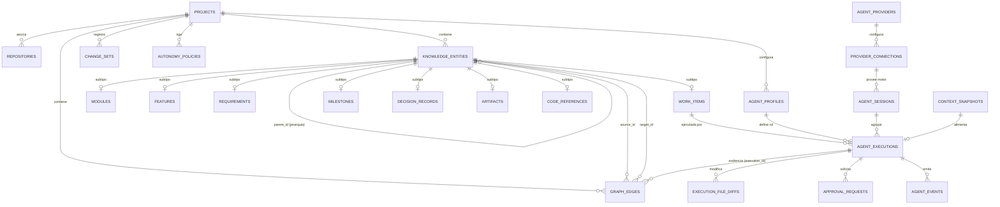

# Domain Model Specification v1 (`DOMAIN.md`)

**Estado del Documento:** Consolidado y Alineado · Versión 1.1  
**Paradigma Arquitectónico:** Modular Monolith · Desktop-First · Local-First  
**Propósito:** Definir la fuente de verdad estructurada, los límites de dominio, las entidades tipadas, el modelo de grafo relacional superpuesto, los contratos de integración de agentes externos y las invariantes de negocio del Workspace.

---

## 1. Visión y Principios Rectores del Dominio

El sistema establece una separación estricta de responsabilidades: **el Workspace es el responsable de la inteligencia, la memoria y la gobernanza del proyecto**, mientras que **los motores externos (Codex, Claude Code, OpenCode, etc.) son responsables de ejecutar el trabajo de desarrollo**.

No construimos otro agente de programación; construimos una plataforma de ingeniería que coordina agentes, conserva el conocimiento estructurado del proyecto y proporciona el contexto y las condiciones de seguridad necesarias para que cualquier motor trabaje con continuidad.

### 1.1. Decisiones Arquitectónicas Consolidadas

| Eje Arquitectónico | Decisión Seleccionada | Implicación en el Dominio |
| :--- | :--- | :--- |
| **Modelo de Grafo** | **Híbrido (Jerarquía + Grafo)** | Una jerarquía (`parent_id`) organiza la pertenencia estructural del proyecto y las relaciones cruzadas (`GraphEdge`) representan dependencias, decisiones, requerimientos y conexiones técnicas. |
| **Ejecución de Agentes** | **Motores Existentes vía Adaptadores** | Integración desacoplada con Codex, Claude Code, OpenCode u otros motores compatibles. El dominio modela perfiles conceptuales (`AgentProfile`) y ejecuciones auditables (`AgentExecution`), nunca motores acoplados. |
| **Interacción Principal** | **Grafo + Chat + Inspector** | El grafo representa el estado estructurado del proyecto; el chat permite consultar, proponer cambios (`ChangeSet`), planificar y ejecutar acciones sobre el mismo contexto de navegación. |
| **Persistencia Híbrida** | **SQLite + Markdown + Git** | SQLite es la fuente de verdad del estado estructurado; Markdown es la fuente de verdad del conocimiento documentado; Git gobierna el historial de versiones; el índice FTS5/vectorial es una proyección reconstruible. |

### 1.2. Los Cinco Principios de Diseño del Dominio

1. **El proyecto tiene una fuente de verdad estructurada:** Ninguna entidad depende de texto libre ambiguo para conocer su estado, jerarquía o relaciones.
2. **El grafo representa conocimiento y relaciones, no solamente tareas:** Las tareas (`WorkItem`) son un subconjunto operativo; el grafo modela también arquitectura (`ADR`), requerimientos, especificaciones, módulos y referencias al código.
3. **La conversación no es la memoria del proyecto:** El chat es un canal de interacción efímero. Todo acuerdo o plan generado en una conversación debe consolidarse mediante un `ChangeSet` en el grafo o en documentos versionados.
4. **Los agentes trabajan con contexto preparado y permisos delimitados:** Ningún agente explora a ciegas ni modifica fuera de su alcance; recibe un `ContextSnapshot` curado y opera bajo una `AutonomyPolicy`.
5. **Toda ejecución deja evidencia y puede reconstruirse posteriormente:** Cada intento de ejecución registra qué contexto exacto recibió, qué herramientas invocó, qué archivos modificó y qué pruebas ejecutó.

---

## 2. Arquitectura del Modelo de Dominio (6 Áreas / Bounded Modules)

Para evitar el antipatrón de una entidad genérica `Node` sin semántica propia, el dominio conserva entidades fuertemente tipadas con comportamiento e invariantes específicas, proyectadas sobre una identidad común de grafo.

1. **Project & Workspace Core:** Raíz del espacio de conocimiento y trabajo (`Project`, `Repository`, `ProjectRule`).
2. **Project Structure & Work Management:** Organización funcional y operativa (`ProjectRoot`, `Module`, `Feature`, `Requirement`, `WorkItem`, `Milestone`).
3. **Knowledge Graph:** Topología y conexiones semánticas (`KnowledgeEntity`, `GraphEdge`, `GraphTopologyService`).
4. **Knowledge & Artifacts:** Documentación viva y decisiones (`DecisionRecord` / ADR, `Artifact` — PRD, Specifications, Plans, Docs — y `CodeReference`).
5. **Context Management & Planning:** Memoria auditable y mutaciones controladas (`ContextSnapshot`, `ContextPackage`, `ChangeSet`).
6. **Agent System & Governance:** Perfiles, proveedores, ejecuciones y control de permisos (`AgentProfile`, `AgentProvider`, `ProviderConnection`, `AgentSession`, `AgentExecution`, `AgentEvent`, `ApprovalRequest`, `AutonomyPolicy`).

---

## 3. Diagrama de Entidades y Relaciones (ERD — Modelo Relacional con Grafo Superpuesto)

El esquema físico en SQLite implementa el patrón **Class Table Inheritance (Supertipo/Subtipo)**. La tabla `knowledge_entities` concentra la identidad común, la revisión del grafo y la jerarquía (`parent_id`), mientras las tablas de subtipo garantizan la integridad de los atributos de cada entidad. Al crearse un `Project`, se instancia automáticamente su nodo ancla `PROJECT_ROOT` en `knowledge_entities` para permitir aristas directas a nivel proyecto (como `DOCUMENTED_BY` hacia `PRD.md` o `ARCHITECTURE.md`).



### 3.1. Catálogo de Tablas Persistidas (SQLite)

| Tabla | Clave Primaria | Columnas Principales | Responsabilidad en el Dominio |
| :--- | :--- | :--- | :--- |
| `projects` | `id` (TEXT) | `name`, `slug`, `description`, `objectives_json`, `tech_stack_json`, `rules_json`, `current_revision` (INT), `created_at`, `updated_at` | Proyecto raíz y contador monotónico de versiones del grafo (`current_revision`). |
| `repositories` | `id` (TEXT) | `project_id`, `name`, `local_path`, `git_provider`, `default_branch`, `head_commit`, `is_primary`, `created_at` | Repositorio Git local asociado al proyecto. |
| `knowledge_entities` | `id` (TEXT) | `project_id`, `entity_type`, `display_key` (ej. `PROJ-01`, `FEAT-04`), `title`, `summary`, `status`, `parent_id`, `created_revision`, `updated_revision`, `created_at`, `updated_at` | Supertipo de todas las entidades del grafo; soporta jerarquía e indexación automática en FTS5 mediante triggers. |
| `modules` | `entity_id` (FK) | `purpose`, `domain_boundary`, `module_kind` (`FUNCTIONAL`, `TECHNICAL`, `SHARED`) | Agrupación funcional o técnica del sistema. |
| `features` | `entity_id` (FK) | `scope`, `priority`, `business_value`, `complexity_estimate` | Capacidad funcional que debe ofrecer el sistema. |
| `requirements` | `entity_id` (FK) | `req_type` (`FUNCTIONAL`, `NON_FUNCTIONAL`, `CONSTRAINT`), `priority`, `acceptance_criteria_json`, `verification_method` | Necesidad verificable del sistema (independiente de la jerarquía estricta). |
| `work_items` | `entity_id` (FK) | `work_type` (`TASK`, `BUG`, `SPIKE`, `IMPROVEMENT`), `priority`, `scope_notes`, `acceptance_criteria_json`, `recommended_profile_role` | Unidad concreta y ejecutable de trabajo. Unifica tareas, bugs, spikes y mejoras. |
| `milestones` | `entity_id` (FK) | `version_tag`, `objectives_json`, `target_date`, `completed_at` | Etapa, corte o versión planificada del proyecto. |
| `decision_records` | `entity_id` (FK) | `adr_number`, `context_md`, `alternatives_md`, `decision_md`, `consequences_md`, `relative_path`, `content_hash`, `sync_status`, `decided_at` | Decisión arquitectónica formal (ADR) sincronizada con su archivo Markdown. |
| `artifacts` | `entity_id` (FK) | `artifact_type` (`PRD`, `ARCHITECTURE`, `SPEC`, `IMPLEMENTATION_PLAN`, `DOMAIN_DOC`, `OTHER`), `repository_id`, `relative_path`, `version`, `content_hash`, `sync_status` | Documento Markdown versionado en el repositorio y vinculado a entidades. |
| `code_references` | `entity_id` (FK) | `repository_id`, `file_path`, `symbol_name`, `symbol_kind`, `line_start`, `line_end`, `commit_sha` | Referencia puntual a archivos, clases o funciones del repositorio. |
| `graph_edges` | `id` (TEXT) | `project_id`, `source_id`, `target_id`, `edge_type`, `provenance` (`USER`, `CHANGESET`, `EXECUTION`), `changeset_id`, `execution_id`, `metadata_json`, `created_revision`, `created_at` | Relaciones cruzadas tipadas entre entidades de `knowledge_entities`. |
| `agent_profiles` | `id` (TEXT) | `project_id`, `role_key` (`PLANNER`, `ARCHITECT`, `DEVELOPER`, `REVIEWER`, `KNOWLEDGE_MANAGER`), `name`, `system_instructions`, `default_provider_id`, `default_policy_id` | Rol conceptual e instrucciones del agente dentro del Workspace. |
| `agent_providers` | `id` (TEXT) | `provider_key` (`codex`, `claude-code`, `opencode`), `display_name`, `adapter_version`, `capabilities_json` | Registro del motor externo y sus 6 capacidades declaradas. |
| `provider_connections` | `id` (TEXT) | `provider_id`, `executable_path`, `server_url`, `config_json`, `health_status`, `last_checked_at` | Configuración local y disponibilidad operativa del motor externo. |
| `agent_sessions` | `id` (TEXT) | `project_id`, `provider_id`, `profile_id`, `external_session_id`, `status`, `created_at`, `last_active_at` | Conversación o sesión persistente mantenida con el proveedor externo. |
| `context_snapshots` | `id` (TEXT) | `project_id`, `execution_id`, `focus_entity_id`, `repository_commit`, `graph_revision`, `constraints_json`, `included_sources_json`, `excluded_sources_json`, `token_usage_json`, `created_at` | Fotografía inmutable del contexto exacto suministrado a un agente o turno de planificación. |
| `agent_executions` | `id` (TEXT) | `project_id`, `work_item_id`, `profile_id`, `provider_id`, `session_id`, `context_snapshot_id` (FK), `status`, `model_used`, `initial_commit`, `final_commit`, `branch_or_worktree`, `test_summary_json`, `result_summary`, `started_at`, `completed_at` | Ejecución auditable de una unidad de trabajo concreta vinculada a su `context_snapshot_id`. |
| `agent_events` | `id` (TEXT) | `execution_id`, `sequence_no`, `event_type`, `payload_json`, `created_at` | Secuencia inmutable de eventos y llamadas a herramientas durante una ejecución. |
| `execution_file_diffs` | `id` (TEXT) | `execution_id`, `repository_id`, `file_path`, `change_type` (`ADDED`, `MODIFIED`, `DELETED`, `RENAMED`), `additions`, `deletions`, `diff_patch` | Evidencia exacta de los archivos tocados por una ejecución. |
| `change_sets` | `id` (TEXT) | `project_id`, `base_graph_revision`, `applied_graph_revision`, `origin_type` (`AI_CHAT`, `AGENT_EXECUTION`, `USER_BULK_ACTION`), `origin_ref_id`, `title`, `rationale`, `status`, `operations_json`, `validation_errors_json`, `created_at`, `applied_at` | Propuesta estructurada de cambios al grafo y documentos generada por el chat, un agente o acción en lote. |
| `autonomy_policies` | `id` (TEXT) | `project_id`, `name`, `writable_paths_json`, `readonly_paths_json`, `denied_paths_json`, `allowed_commands_json`, `auto_approve_scopes_json`, `require_worktree_isolation` | Reglas de permisos, rutas y comandos autorizados para las ejecuciones. |
| `approval_requests` | `id` (TEXT) | `execution_id`, `scope`, `requested_action`, `reason`, `status` (`PENDING`, `APPROVED`, `REJECTED`), `resolved_by`, `resolution_note`, `requested_at`, `resolved_at` | Solicitud de autorización en tiempo de ejecución o para aplicar cambios restringidos. |

---

## 4. Definición de Agregados, Entidades y Value Objects (DDD)

Las mutaciones de estado en la capa `domain/` se realizan exclusivamente a través de **Aggregate Roots**, garantizando consistencia transaccional.

### 4.1. Agregado `Project` (Workspace Core)
* **Raíz de Agregado:** `Project`
* **Entidades Internas:** `Repository`, `ProjectRule`, `ProjectRootEntity`
* **Value Objects:**
  * `ProjectId`: Identificador único.
  * `GraphRevision`: Entero monotónico (`1, 2, 3...`) que avanza con cada mutación estructural del proyecto.
  * `TechStackProfile`: Lenguajes, frameworks, gestores de paquetes y comandos estándar de test/build.
* **Comportamiento Clave:** Incrementar revisión, registrar repositorios, validar reglas globales del proyecto.

### 4.2. Agregado `KnowledgeEntity` (Project Structure & Artifacts)
* **Raíz de Agregado Polimórfica:** `KnowledgeEntity`
  * Especializaciones concretas: `ProjectRoot`, `Module`, `Feature`, `Requirement`, `WorkItem`, `Milestone`, `DecisionRecord`, `Artifact`, `CodeReference`.
* **Value Objects:**
  * `EntityKey`: Identificador legible por humanos auto-secuenciado por proyecto (`PROJ-01`, `MOD-01`, `FEAT-12`, `TASK-105`, `ADR-003`).
  * `WorkItemType`: `'TASK' | 'BUG' | 'SPIKE' | 'IMPROVEMENT'`.
  * `AgentProfileRole`: `'PLANNER' | 'ARCHITECT' | 'DEVELOPER' | 'REVIEWER' | 'KNOWLEDGE_MANAGER'`.
  * `AcceptanceCriterion`: `{ id: string; description: string; verified: boolean; verificationRef?: string }`.
  * `ArtifactSyncState`: `{ contentHash: string; syncStatus: 'SYNCED' | 'DRIFTED' | 'MISSING' | 'UNTRACKED'; lastCheckedAt: string }`.
* **Separación Dominio vs. Visualización:**
  Las entidades de dominio nunca se exponen crudas a la librería de renderizado. El caso de uso proyecta las entidades hacia contratos ligeros de presentación (`GraphNodeView` y `GraphEdgeView`):

```typescript
export type KnowledgeEntityType =
  | 'PROJECT_ROOT'
  | 'MODULE'
  | 'FEATURE'
  | 'REQUIREMENT'
  | 'WORK_ITEM'
  | 'MILESTONE'
  | 'DECISION_RECORD'
  | 'ARTIFACT'
  | 'CODE_REFERENCE';

export type GraphEdgeType =
  | 'DEPENDS_ON'
  | 'IMPLEMENTS'
  | 'SATISFIES'
  | 'AFFECTS'
  | 'SUPERSEDES'
  | 'DOCUMENTED_BY'
  | 'VERIFIED_BY'
  | 'TOUCHES_CODE'
  | 'MODIFIES'
  | 'GENERATED_BY'
  | 'SCOPED_IN';

// Modelos exclusivos de proyección para la capa de presentación (UI)
export interface GraphNodeView {
  id: string;
  key: string;
  type: KnowledgeEntityType;
  subType?: string; // Ej. 'TASK' | 'BUG' | 'SPIKE' o 'PRD' | 'SPEC'
  label: string;
  status: string;
  parentId?: string;
  metadata?: Record<string, unknown>;
}

export interface GraphEdgeView {
  id: string;
  source: string;
  target: string;
  type: GraphEdgeType;
  provenance: 'USER' | 'CHANGESET' | 'EXECUTION';
}
```

### 4.3. Agregado `GraphRelationship` y Servicio `GraphTopologyService`
* **Raíz de Agregado:** `GraphRelationship` (persistida en `graph_edges`).
* **Value Objects:** `GraphEdgeType`, `EdgeProvenance`.
* **Servicio de Dominio (`GraphTopologyService`):** Valida que la creación o movimiento de un `parent_id` o de un `GraphEdge` respete la matriz de compatibilidad de tipos y no introduzca ciclos en relaciones dirigidas acíclicas (DAG).

### 4.4. Agregado `AgentExecution` (Agent System)
* **Raíz de Agregado:** `AgentExecution`
* **Entidades Internas:** `AgentEvent`, `ExecutionFileDiff`, `ApprovalRequest`
* **Value Objects:**
  * `ExecutionStatus`: `'QUEUED' | 'PREPARING_CONTEXT' | 'RUNNING' | 'AWAITING_APPROVAL' | 'VALIDATING' | 'COMPLETED' | 'FAILED' | 'CANCELLED'`.
  * `WorkspaceIsolation`: `{ mode: 'WORKTREE' | 'BRANCH' | 'IN_PLACE'; workingDir: string; branchName: string; baseCommit: string; finalCommit?: string }`.
  * `TestExecutionReport`: `{ command: string; passed: number; failed: number; skipped: number; exitCode: number; logFilePath: string }`.

### 4.5. Agregado `ContextSnapshot` (Context Management)
* **Raíz de Agregado:** `ContextSnapshot` (Inmutable tras su sellado).
* **Value Objects:** `ContextSourceEntry`, `ExcludedSourceEntry`, `ContextAuthorityTier` (`1..6`), `TokenBudgetAllocation`.

### 4.6. Agregado `ChangeSet` (Planning & Safe Mutations)
* **Raíz de Agregado:** `ChangeSet`
* **Entidades Internas:** `ChangeSetOperation`
* **Value Objects:**
  * `ChangeSetStatus`: `'PENDING_APPROVAL' | 'VALIDATED' | 'CONFLICTED' | 'APPLIED' | 'REJECTED'`.
  * `ChangeSetOriginType`: `'AI_CHAT' | 'AGENT_EXECUTION' | 'USER_BULK_ACTION'`.
  * `ValidationIssue`.

---

## 5. Jerarquía y Matriz de Relaciones del Grafo

El modelo distingue estrictamente entre **pertenencia organizativa** (`parent_id`) y **relaciones semánticas cruzadas** (`GraphEdge`).

### 5.1. Reglas de Jerarquía Principal (`parent_id`)

```text
ProjectRoot (PROJ-01: Nodo raíz ancla del proyecto, parent_id = NULL)
 └── Module (Agrupación funcional o técnica — admite submódulos)
      └── Feature (Capacidad funcional del sistema)
           └── WorkItem (Unidad concreta de trabajo: Task | Bug | Spike | Improvement)
                └── WorkItem (Subtarea opcional — máximo 1 nivel de anidamiento)
```

**Excepciones explícitas a la jerarquía estricta:**
* **`Requirement`:** No depende obligatoriamente de un `Module` o `Feature` en su `parent_id` (`parent_id = NULL` o `PROJECT_ROOT` permitido). Un requerimiento puede ser satisfecho por múltiples features y una feature puede satisfacer múltiples requerimientos mediante aristas `SATISFIES`.
* **`DecisionRecord` (ADR) y `Artifact`:** Tienen existencia transversal en el proyecto (`parent_id` nulo, `PROJECT_ROOT` o `MODULE`) y se conectan a módulos, features y tareas mediante aristas `AFFECTS` y `DOCUMENTED_BY`.

### 5.2. Catálogo y Reglas de Aristas del Grafo (`GraphEdge`)

| Tipo de Relación (`edge_type`) | Entidad Origen Permitida (`source`) | Entidad Destino Permitida (`target`) | Regla Topológica | Semántica e Impacto en el Context Engine |
| :--- | :--- | :--- | :--- | :--- |
| `DEPENDS_ON` | `WORK_ITEM`, `FEATURE`, `MODULE` | Mismo tipo que el origen | **DAG estricto** (Prohibidos los ciclos) | Indica prelación técnica o funcional. Bloquea el paso a ejecución si el destino no está completado e incluye sus salidas en el contexto. |
| `IMPLEMENTS` | `WORK_ITEM` | `FEATURE`, `REQUIREMENT` | Muchos a Muchos (Irreflexiva) | Vincula la unidad de trabajo con la capacidad o necesidad que construye. |
| `SATISFIES` | `FEATURE` | `REQUIREMENT` | Muchos a Muchos | Expresa qué funcionalidades dan cumplimiento a qué requerimientos del sistema. |
| `AFFECTS` | `DECISION_RECORD` | `PROJECT_ROOT`, `MODULE`, `FEATURE`, `WORK_ITEM`, `REQUIREMENT` | Muchos a Muchos | **Inyección Prioritaria (Nivel 2):** Obliga al Context Engine a incluir el ADR vigente cuando se trabaja sobre la entidad destino. |
| `SUPERSEDES` | `DECISION_RECORD` | `DECISION_RECORD` | **DAG estricto** (Irreflexiva) | Indica que un nuevo ADR reemplaza a uno anterior. Transiciona el ADR destino a `SUPERSEDED` y lo excluye del contexto activo. |
| `DOCUMENTED_BY` | `PROJECT_ROOT`, `MODULE`, `FEATURE`, `REQUIREMENT`, `WORK_ITEM` | `ARTIFACT` | Muchos a Muchos | Conecta entidades estructurales con sus especificaciones, planes o PRDs en Markdown. |
| `VERIFIED_BY` | `REQUIREMENT`, `FEATURE`, `WORK_ITEM` | `ARTIFACT`, `CODE_REFERENCE` | Muchos a Muchos | Conecta criterios de aceptación con planes de prueba o archivos de test automatizados. |
| `TOUCHES_CODE` | `MODULE`, `FEATURE`, `WORK_ITEM`, `DECISION_RECORD` | `CODE_REFERENCE` | Muchos a Muchos | Ancla nodos del grafo a archivos, clases o símbolos reales del repositorio Git. |
| `MODIFIES` | `WORK_ITEM` *(con `execution_id`)* | `CODE_REFERENCE` | Generada por evidencia (`provenance = 'EXECUTION'`) | Registra qué referencias de código fueron alteradas al ejecutar una tarea. |
| `GENERATED_BY` | `ARTIFACT`, `DECISION_RECORD` | `WORK_ITEM` *(con `execution_id`)* | Generada por evidencia (`provenance = 'EXECUTION'`) | Traza qué ejecución de agente produjo o actualizó un documento del proyecto. |
| `SCOPED_IN` | `FEATURE`, `WORK_ITEM` | `MILESTONE` | Muchos a Uno por etapa | Asigna capacidades o tareas a una entrega o versión del proyecto. |

---

## 6. Máquinas de Estado: Tareas vs. Ejecuciones

El estado de la unidad de trabajo (`WorkItem`) está desacoplado del estado de la ejecución del agente (`AgentExecution`). Una misma tarea puede requerir múltiples ejecuciones manteniendo la trazabilidad intacta.

### 6.1. Ciclo de Vida de `WorkItem`

```text
[DRAFT] ──► [READY] ──► [IN_PROGRESS] ──► [IN_REVIEW] ──► [DONE]
               │              │                │
               ▼              ▼                ▼
           [BLOCKED] ◄────────┴────────────────┘
               │
               ▼
          [ARCHIVED]
```

| Estado | Significado en el Dominio | Condición de Entrada / Transición |
| :--- | :--- | :--- |
| `DRAFT` | Tarea recién propuesta o en definición. | Creada manualmente o recién aplicada desde un `ChangeSet` inicial sin criterios completos. |
| `READY` | Lista para ser asignada a un agente o desarrollador. | Tiene alcance claro, criterios de aceptación y **ninguna** dependencia `DEPENDS_ON` pendiente. |
| `BLOCKED` | No puede ejecutarse todavía. | Al menos una tarea destino en `DEPENDS_ON` no está en estado `DONE`, o existe un bloqueo externo. |
| `IN_PROGRESS` | Trabajo activo en curso. | Se inicia la primera `AgentExecution` asociada o el usuario la marca en curso. |
| `IN_REVIEW` | Código/artefacto generado pendiente de validación final. | Una `AgentExecution` asociada culmina en estado `COMPLETED`. |
| `DONE` | Criterios de aceptación verificados y cambios integrados. | Aprobación del usuario o del perfil `Reviewer` tras superar validaciones. |
| `ARCHIVED` | Descartada o reemplazada por re-planificación. | Acción explícita o aplicación de un `ChangeSet` de limpieza. |

### 6.2. Ciclo de Vida de `AgentExecution`

```text
   QUEUED
     │
     ▼
PREPARING_CONTEXT
     │
     ▼
  RUNNING ────────► AWAITING_APPROVAL
     │                     │
     │◄────────────────────┘
     ▼
 VALIDATING
     │
     ├──────────► COMPLETED
     │
     ├──────────► FAILED
     │
     └──────────► CANCELLED
```

| Estado | Responsable | Acciones y Reglas de Transición |
| :--- | :--- | :--- |
| `QUEUED` | `AgentOrchestrator` | La solicitud de ejecución ha sido creada y espera disponibilidad del motor y del worktree. |
| `PREPARING_CONTEXT` | `ContextEngine` + `GitIsolationService` | Se crea/verifica la rama o Git worktree, se recorre el grafo y se sella el `ContextSnapshot` inmutable. |
| `RUNNING` | `AgentAdapter` (Motor externo) | El motor externo está trabajando y emitiendo `AgentEvent` en streaming hacia el Workspace. |
| `AWAITING_APPROVAL` | `GovernanceInterceptor` | El motor solicitó ejecutar un comando o modificar una ruta restringida. La ejecución se pausa hasta recibir `ApprovalDecision`. |
| `VALIDATING` | `ExecutionValidator` | El motor terminó su turno. El Workspace captura el `git diff`, verifica que no se violaron rutas prohibidas y ejecuta los tests configurados. |
| `COMPLETED` | `AgentOrchestrator` | Validaciones superadas. Se sella la evidencia (commit/diff, aristas `MODIFIES` / `GENERATED_BY`, métricas) y el `WorkItem` pasa a `IN_REVIEW`. |
| `FAILED` | `AgentOrchestrator` | Error del motor, pruebas fallidas o violación de política. Se conserva el log y el diff para diagnóstico forense. |
| `CANCELLED` | Usuario / Sistema | Interrupción solicitada por el usuario o por timeout. Se detiene el proceso del adaptador de forma segura. |

---

## 7. Especificación de `ContextSnapshot` y Prioridades del Context Engine

El `ContextEngine` construye el paquete de contexto combinando resolución directa, recorrido del grafo (`Graph Traversal`), búsqueda full-text/semántica y presupuestación de tokens (`Context Ranking`).

### 7.1. Jerarquía de Autoridad de las Fuentes de Conocimiento

Cuando existe límite de tokens o contradicción potencial entre fuentes, el `ContextEngine` aplica estrictamente este orden de prioridad:

| Nivel de Prioridad | Fuente de Conocimiento | Regla de Gobernanza en el Context Package |
| :---: | :--- | :--- |
| **1 (Máxima)** | **Restricciones y políticas vigentes del proyecto** | **Innegociables.** Siempre incluidas al inicio del prompt (`constraints`). Ningún agente puede ignorarlas. |
| **2** | **ADRs aceptados (`ACCEPTED`)** | Recuperados vía aristas `AFFECTS` hacia la tarea, su feature, su módulo o el proyecto. Prevalecen sobre cualquier documento o chat. |
| **3** | **Requerimientos y especificaciones aprobadas** | Criterios de aceptación del `WorkItem`, su `Feature` (`IMPLEMENTS`) y `Requirement` (`SATISFIES`), junto con su `specification.md`. |
| **4** | **Estado real del repositorio (Código y Tests)** | Archivos anclados vía `TOUCHES_CODE` validados contra el `HEAD` commit actual. Ante discrepancia con un documento antiguo, el código actual refleja la realidad técnica. |
| **5** | **Documentación técnica e histórica general** | `ARCHITECTURE.md`, `PRD.md`, planes de implementación y tareas hermanas completadas (`DEPENDS_ON`). |
| **6 (Mínima)** | **Conversaciones y notas no consolidadas** | Fragmentos de chat recientes o notas exploratorias. Nunca pueden contradecir silenciosamente los niveles 1 a 4. |

### 7.2. Estructura de Datos de `ContextSnapshot`

```typescript
export type ContextAuthorityTier = 1 | 2 | 3 | 4 | 5 | 6;

export interface ContextSourceEntry {
  sourceId: string;                  // UUID de la entidad o ruta relativa del archivo
  entityKey?: string;                // Ej. "ADR-001", "FEAT-04", "TASK-125"
  sourceType: 'POLICY' | 'ADR' | 'REQUIREMENT' | 'SPECIFICATION' | 'WORK_ITEM' | 'CODE_FILE' | 'DOC' | 'CHAT_NOTE';
  titleOrPath: string;               // Ej. "docs/architecture/ADR/ADR-001.md" o "src/services/SalesService.ts"
  authorityTier: ContextAuthorityTier;
  retrievalOrigin: 'FOCUS_NODE' | 'HIERARCHY_PARENT' | 'GRAPH_EDGE' | 'FULL_TEXT_SEARCH' | 'SEMANTIC_SEARCH';
  viaEdgeType?: GraphEdgeType;       // Ej. "AFFECTS", "IMPLEMENTS", "DEPENDS_ON"
  graphDistance: number;             // 0 = foco, 1 = vecino directo, 2 = indirecto
  contentHash: string;               // SHA-256 del contenido exacto en el instante de la captura
  extractedContent: string;          // Contenido o fragmento inyectado al paquete
  tokenCount: number;
}

export interface ExcludedSourceEntry {
  sourceId: string;
  titleOrPath: string;
  authorityTier: ContextAuthorityTier;
  exclusionReason: 'TOKEN_BUDGET_EXCEEDED' | 'SUPERSEDED_DECISION' | 'LOW_RELEVANCE_SCORE' | 'DRIFTED_UNVERIFIED';
}

export interface ContextSnapshot {
  id: string;
  projectId: string;
  executionId: string | null;        // null cuando el snapshot respalda una sesión de planificación en Chat
  focusEntityId: string;             // Nodo principal desde el que se resolvió el contexto
  repositoryCommit: string;          // SHA exacto del repositorio Git al armar el paquete
  graphRevision: number;             // Revisión exacta del grafo en SQLite
  createdAt: string;
  tokenUsage: {
    maxAllowedTokens: number;
    totalUsedTokens: number;
  };
  constraints: string[];             // Ej. ["No modificar producción", "Mantener compatibilidad con API actual"]
  includedSources: ContextSourceEntry[];
  excludedSources: ExcludedSourceEntry[];
}
```

---

## 8. Contratos del Agent Integration Layer

El `AgentOrchestrator` nunca invoca binarios ni SDKs propietarios directamente; opera contra el contrato `AgentAdapter`. Cada proveedor declara sus capacidades reales mediante los 6 indicadores de `AgentCapabilities` para que el Workspace jamás simule comportamientos inexistentes.

```typescript
export type AgentProviderId = 'codex' | 'claude-code' | 'opencode';

export type AgentProfileRole = 'PLANNER' | 'ARCHITECT' | 'DEVELOPER' | 'REVIEWER' | 'KNOWLEDGE_MANAGER';

export interface AgentCapabilities {
  supportsResume: boolean;           // Permite reanudar una sesión previa por externalSessionId
  supportsStreaming: boolean;        // Emite eventos incrementales en tiempo real
  supportsApprovals: boolean;        // Permite pausar una tool call esperando autorización del Workspace
  supportsCancellation: boolean;     // Soporta abortar la ejecución en curso limpiamente
  supportsStructuredOutput: boolean; // Garantiza respuestas JSON ajustadas a esquema (ej. para ChangeSets)
  supportsWorktrees: boolean;        // Soporta trabajar sobre directorios Git worktree aislados
}

export interface ExecutionSandboxConfig {
  workingDirectory: string;          // Ruta absoluta del repositorio o Git worktree aislado
  writablePaths: string[];           // Glob patterns autorizados para escritura
  readOnlyPaths: string[];           // Glob patterns de solo lectura (ej. ADRs aceptados)
  deniedPaths: string[];             // Rutas bloqueadas (ej. .env, secretos, configuración crítica)
  allowedCommands: string[];         // Lista blanca de comandos de terminal permitidos sin pausa
}

export interface AgentExecutionRequest {
  executionId: string;
  projectId: string;
  workItemId?: string;
  profile: {
    id: string;
    role: AgentProfileRole;
    systemPrompt: string;
    preferredModel?: string;
  };
  contextSnapshot: ContextSnapshot;
  instructionPrompt: string;
  sandbox: ExecutionSandboxConfig;
  expectedOutputSchema?: Record<string, unknown>;
}

export type ApprovalDecision =
  | { approved: true; scope: 'ONCE' | 'SESSION'; note?: string }
  | { approved: false; reason: string };

export type AgentEvent =
  | { type: 'SESSION_INITIALIZED'; timestamp: string; externalSessionId: string; model?: string }
  | { type: 'TEXT_DELTA'; timestamp: string; delta: string }
  | { type: 'TOOL_INVOCATION_STARTED'; timestamp: string; callId: string; toolName: string; args: Record<string, unknown> }
  | { type: 'TOOL_INVOCATION_FINISHED'; timestamp: string; callId: string; resultPreview: string; isError: boolean }
  | { type: 'FILE_TOUCHED'; timestamp: string; relativePath: string; operation: 'CREATE' | 'EDIT' | 'DELETE' }
  | { type: 'APPROVAL_REQUIRED'; timestamp: string; requestId: string; actionType: 'COMMAND' | 'FILE_WRITE' | 'NETWORK'; target: string; justification?: string }
  | { type: 'CHANGESET_PROPOSED'; timestamp: string; proposal: ChangeSet }
  | { type: 'EXECUTION_FINISHED'; timestamp: string; summary: string; usage?: { inputTokens: number; outputTokens: number } }
  | { type: 'EXECUTION_FAILED'; timestamp: string; errorCode: string; errorMessage: string; isRecoverable: boolean };

export interface AgentAdapter {
  readonly providerId: AgentProviderId;

  getCapabilities(): Promise<AgentCapabilities>;

  checkAvailability(): Promise<{
    available: boolean;
    version?: string;
    diagnostics?: string;
  }>;

  startExecution(
    request: AgentExecutionRequest
  ): AsyncIterable<AgentEvent>;

  resumeExecution(
    sessionId: string,
    request: AgentExecutionRequest
  ): AsyncIterable<AgentEvent>;

  interruptExecution(
    executionId: string
  ): Promise<void>;

  respondToApproval(
    executionId: string,
    requestId: string,
    decision: ApprovalDecision
  ): Promise<void>;
}
```

---

## 9. Modelo de `ChangeSet`: Comunicación Segura entre Chat, Agentes y Grafo

Ni el chat ni los agentes modifican directamente las tablas del grafo. Toda intención de crear o alterar módulos, features, requerimientos, documentos, tareas o relaciones se materializa como un `ChangeSet` que el dominio valida antes de mostrar su vista previa o aplicarlo.

```typescript
export type ChangeSetOriginType = 'AI_CHAT' | 'AGENT_EXECUTION' | 'USER_BULK_ACTION';

export type ChangeSetStatus = 'PENDING_APPROVAL' | 'VALIDATED' | 'CONFLICTED' | 'APPLIED' | 'REJECTED';

export type ChangeSetOperation =
  | {
      type: 'CREATE_MODULE';
      tempId: string;                // Identificador temporal local al lote (ej. "$mod_auth")
      parentId?: string | null;      // null o UUID del PROJECT_ROOT / módulo padre
      title: string;
      summary: string;
      purpose: string;
      moduleKind?: 'FUNCTIONAL' | 'TECHNICAL' | 'SHARED';
    }
  | {
      type: 'CREATE_FEATURE';
      tempId: string;                // Ej. "$feat_2fa"
      moduleId: string;              // UUID real o tempId ("$mod_auth")
      title: string;
      summary: string;
      scope: string;
      priority: 'LOW' | 'MEDIUM' | 'HIGH' | 'CRITICAL';
    }
  | {
      type: 'CREATE_REQUIREMENT';
      tempId: string;                // Ej. "$req_totp"
      parentId?: string | null;
      title: string;
      summary: string;
      reqType: 'FUNCTIONAL' | 'NON_FUNCTIONAL' | 'CONSTRAINT';
      priority: 'LOW' | 'MEDIUM' | 'HIGH' | 'CRITICAL';
      acceptanceCriteria: string[];
    }
  | {
      type: 'CREATE_WORK_ITEM';
      tempId: string;                // Ej. "$task_1"
      parentId: string;              // UUID o tempId de la Feature o WorkItem padre
      workType: 'TASK' | 'BUG' | 'SPIKE' | 'IMPROVEMENT';
      priority?: 'LOW' | 'MEDIUM' | 'HIGH' | 'CRITICAL';
      title: string;
      summary: string;
      acceptanceCriteria: string[];
      recommendedProfileRole?: AgentProfileRole;
    }
  | {
      type: 'CREATE_DECISION_RECORD';
      tempId: string;
      title: string;
      contextMd: string;
      alternativesMd: string;
      decisionMd: string;
      consequencesMd: string;
      relativePath: string;          // Ej. "docs/architecture/ADR/ADR-003.md"
    }
  | {
      type: 'UPSERT_ARTIFACT';
      tempId?: string;
      entityId?: string;             // Si actualiza un artefacto existente
      parentId?: string | null;
      artifactType: 'PRD' | 'ARCHITECTURE' | 'SPEC' | 'IMPLEMENTATION_PLAN' | 'DOMAIN_DOC' | 'OTHER';
      title: string;
      relativePath: string;          // Ej. "docs/features/authentication/specification.md"
      markdownContent: string;
    }
  | {
      type: 'UPDATE_ENTITY_STATUS';
      entityId: string;
      newStatus: string;
      reason: string;
    }
  | {
      type: 'CREATE_RELATIONSHIP';
      sourceId: string;              // UUID existente o tempId ("$task_1")
      targetId: string;              // UUID existente o tempId ("$feat_2fa")
      edgeType: GraphEdgeType;
      metadata?: Record<string, unknown>;
    }
  | {
      type: 'DELETE_RELATIONSHIP';
      edgeId: string;
      reason: string;
    };

export interface ChangeSet {
  id: string;
  projectId: string;
  baseGraphRevision: number;         // Revisión del grafo sobre la cual se calculó la propuesta
  appliedGraphRevision?: number;     // Revisión asignada al aplicarse transaccionalmente
  originType: ChangeSetOriginType;
  originRefId?: string;              // sessionId o executionId según corresponda
  title: string;                     // Ej. "Agregar autenticación 2FA al módulo de usuarios"
  rationale: string;
  status: ChangeSetStatus;
  operations: ChangeSetOperation[];
  validationIssues: Array<{
    operationIndex: number;
    severity: 'ERROR' | 'WARNING';
    code: string;
    message: string;
  }>;
  createdAt: string;
  appliedAt?: string;
}
```

---

## 10. Reglas de Negocio e Invariantes del Dominio

El núcleo del dominio (`src/domain/`) aplica las siguientes invariantes de forma obligatoria antes de confirmar cualquier persistencia en SQLite o escritura de documentos en el sistema de archivos:

### Invariante 1: Aciclicidad Estricta en Jerarquía y Dependencias (DAG)
* **Jerarquía (`parent_id`):** Ninguna entidad puede ser ancestro de sí misma directa o indirectamente.
* **Dependencias (`DEPENDS_ON`) y Reemplazos (`SUPERSEDES`):** El subgrafo formado por las aristas `DEPENDS_ON` entre `WorkItem` (o entre `Feature` / `Module`) y las aristas `SUPERSEDES` entre `DecisionRecord` debe ser un **Grafo Dirigido Acíclico (DAG)**. Si un `ChangeSet` intenta introducir un ciclo ($A \to B \to C \to A$), `GraphTopologyService` rechaza la operación con el error `CYCLE_DETECTED`.

### Invariante 2: Tipado Estricto de Relaciones y Autorreflexión Prohibida
* Ninguna arista puede tener el mismo nodo como origen y destino (`source_id !== target_id`).
* Toda arista debe cumplir la **Matriz de Compatibilidad de Aristas** (Sección 5.2).

### Invariante 3: Inmutabilidad de Evidencia Forense
* Un `ContextSnapshot` vinculado a una `AgentExecution` que ha iniciado (`status !== 'QUEUED'`) es **estrictamente inmutable**.
* Una `AgentExecution` en estado terminal (`COMPLETED`, `FAILED`, `CANCELLED`) y su lista de `AgentEvent` y `ExecutionFileDiff` constituyen un registro de auditoría de solo lectura (`append-only`).

### Invariante 4: Prevalencia Jerárquica de Autoridad en el Contexto
* El `ContextEngine` jamás puede descartar por límite de tokens una restricción de proyecto (Nivel 1) o un ADR en estado `ACCEPTED` que afecte al nodo actual (Nivel 2) mientras conserve elementos de niveles inferiores (Niveles 5 o 6).
* Un `DecisionRecord` con estado `SUPERSEDED` es excluido automáticamente del contexto activo de ejecución y reemplazado por el ADR vigente que lo sustituyó.

### Invariante 5: Integridad Transaccional y Control de Concurrencia en `ChangeSet`
* Al aplicar un `ChangeSet`, todas las referencias simbólicas temporales (`tempId`, como `"$feat_2fa"`) se resuelven a UUIDs definitivos en una única transacción atómica de SQLite junto con la escritura de los archivos Markdown asociados.
* Si el `current_revision` del proyecto avanzó desde el `baseGraphRevision` del `ChangeSet` y alguna de las entidades modificadas fue alterada en el ínterin, el `ChangeSet` se marca como `CONFLICTED` y no puede aplicarse sin re-validación.
* La aplicación exitosa de un `ChangeSet` incrementa `projects.current_revision` en `+1`.

### Invariante 6: Sincronización Explícita entre Base de Datos y Documentos Markdown
* Los documentos de conocimiento (`PRD.md`, `ARCHITECTURE.md`, `ADR-xxx.md`, `specification.md`, `implementation-plan.md`) residen físicamente en la estructura `docs/` del repositorio Git, mientras sus nodos y relaciones residen en SQLite.
* Antes de construir un `ContextSnapshot`, el Workspace verifica el hash SHA-256 del archivo en disco contra `artifacts.content_hash`. Si difieren, actualiza el estado a `DRIFTED`, re-indexa el contenido real del disco y deja constancia en el snapshot.

### Invariante 7: Gobernanza del Entorno de Ejecución
* El motor externo nunca es la autoridad sobre dónde ni cómo se ejecuta el código. El `AgentOrchestrator` impone la política `AutonomyPolicy` activa: valida el directorio de trabajo (Git worktree o rama), intercepta solicitudes de aprobación cuando `supportsApprovals` está disponible y verifica en la fase `VALIDATING` que ningún archivo fuera de `writablePaths` o dentro de `deniedPaths` haya sido modificado antes de dar por buena la ejecución.

---

## 11. Organización Física de Artefactos y Almacenamiento Local

El modelo de dominio respeta la separación entre los artefactos versionables del repositorio y la base de datos operativa del Workspace:

```text
<Repositorio-del-Proyecto>/               # Gobernado por Git (Fuente de verdad documental y código)
├── docs/
│   ├── product/
│   │   └── PRD.md                        # Artifact (type: PRD)
│   ├── architecture/
│   │   ├── ARCHITECTURE.md               # Artifact (type: ARCHITECTURE)
│   │   └── ADR/
│   │       ├── ADR-001.md                # DecisionRecord (ADR-001)
│   │       └── ADR-002.md                # DecisionRecord (ADR-002)
│   ├── features/
│   │   └── <feature-slug>/
│   │       ├── specification.md          # Artifact (type: SPEC)
│   │       └── implementation-plan.md    # Artifact (type: IMPLEMENTATION_PLAN)
│   └── domain/
│       └── DOMAIN.md                     # Artifact (type: DOMAIN_DOC)
├── src/                                  # Anclado vía CodeReference
└── tests/                                # Anclado vía CodeReference (VERIFIED_BY)

<Almacenamiento-Local-del-Workspace>/     # Fuera de Git (Fuente de verdad operativa y estructural)
└── projects/
    └── <project-id>/
        ├── workspace.sqlite              # Entidades, grafo, ChangeSets, ejecuciones y FTS5
        ├── snapshots/                    # Paquetes de ContextSnapshot serializados
        ├── worktrees/                    # Directorios de aislamiento Git por ejecución activa
        ├── executions/
        │   └── <execution-id>/
        │       ├── events.jsonl          # Stream bruto de eventos del adaptador
        │       ├── changes.patch         # Diff completo generado por la ejecución
        │       └── test-output.log       # Salida de validación de pruebas
        └── exports/                      # Paquetes versionados para portabilidad de la base de conocimiento
```